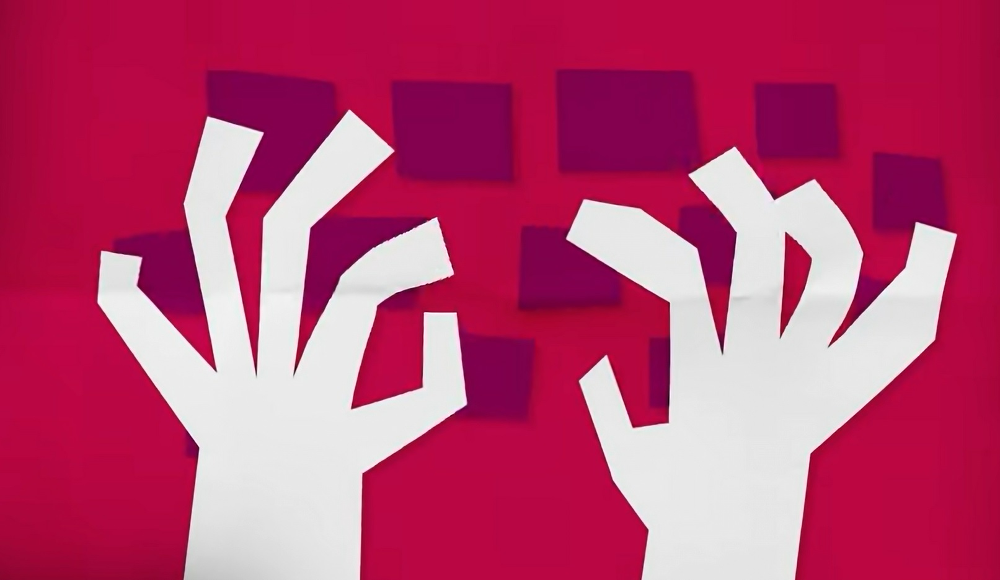
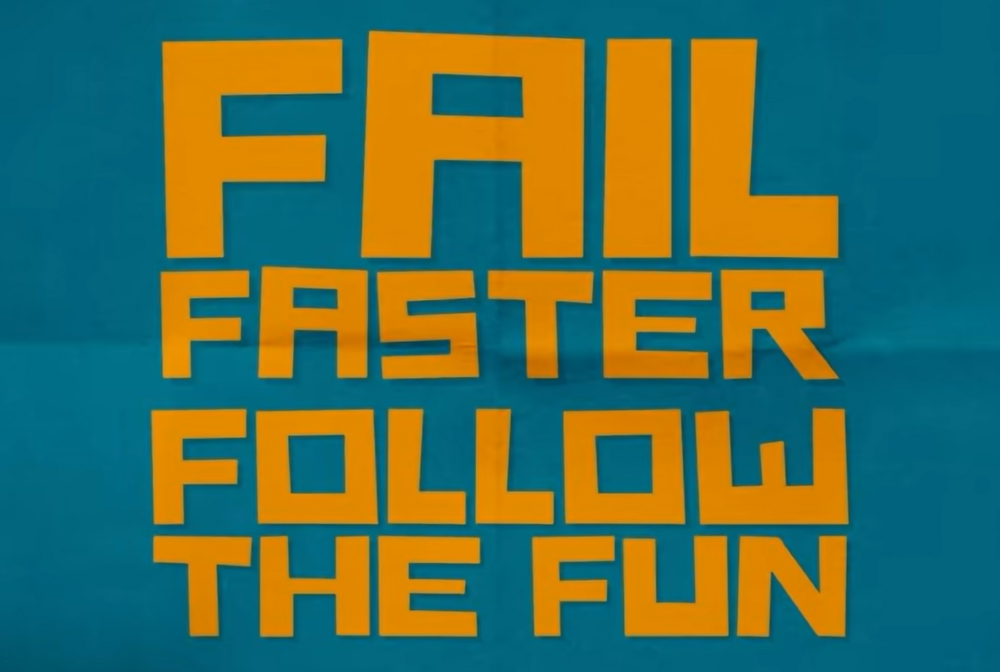
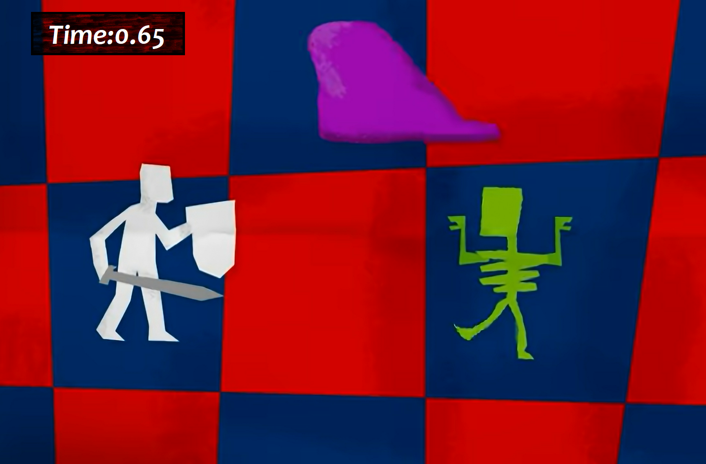
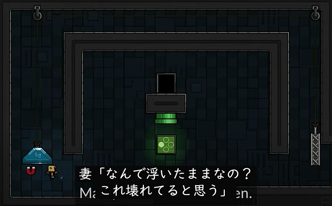
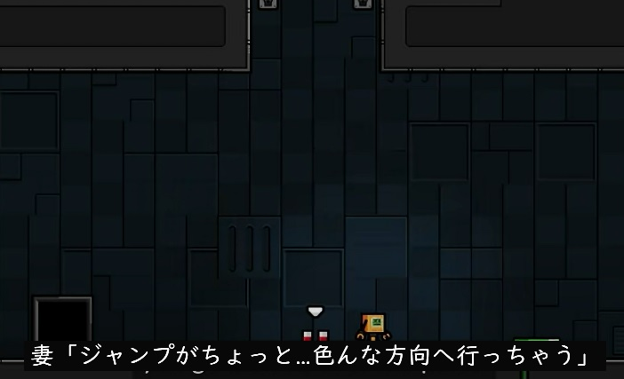
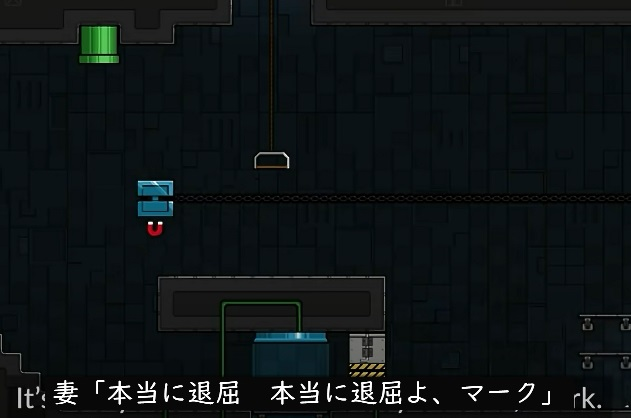
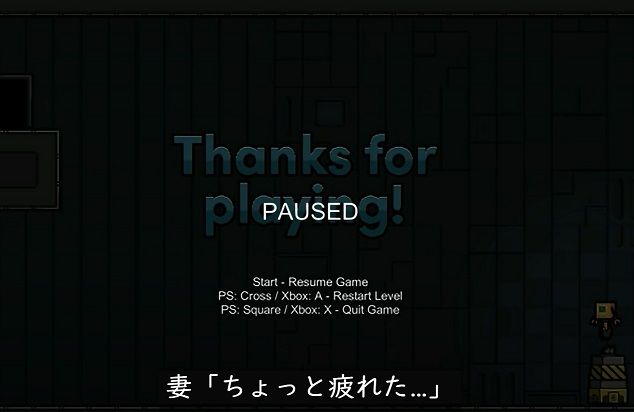

[ゲームデザイン改善ガイド 第05回]

# アイデアを試作する

## 1. アイデア出しに時間をかけない

 
[とにかく手を動かして試す(www.youtube.com/watch?v=kMDe7_YwVKI)]

### 思いついたらすぐ試す

「それほど難しくないだろう」と考えていたアイデアが、実際に試作してみると、

&emsp;**さまざまな問題が起きて、なかなか思うようにいかない**

というのは、よくある話です。「組み合わせたら面白そう」と思っていたアイデアが、実際に試作してみると、

&emsp;**アイデア同士が噛み合わなくて、思ったほど面白くなかった**

というのも、よくある話です。逆に、試作してみたら

&emsp;**想定外の面白さが見つかった**

ということもありえます。その場合は、見つけた面白さを改めて追求することになります。

開発の初期段階でこれらのことが起きた場合、それはほとんど問題になりません。 
試作にかけた時間はわずかで、大抵はまだグラフィックスや音声などのアセットも作成していないからです。

しかし、既にほとんどゲームが完成している場合は話が変わります。 
プログラムやグラフィック、その他多くのデータを一から作り直す時間も予算も残っていないからです。 
当初のアイデアのままなんとかゲームを完成させるか、あきらめてゲームを放棄するしかありません。

これは就職作品の制作でも同じことです。 
しかし、 **掛けられる時間がずっと少なく、期限を変えられない** という違いがあります。 
そう考えると、就職作品のほうが実際のゲーム開発より大変かもしれません。

### 試してみないと分からない

さて、ゲームを作る場合、とにかく何らかのアイデアが必要です。ですが、アイデアが思いつかなくても、 
**既存のゲームからアイデアを借りる** ことで、アイデア出しの時間を短縮できます。 
既存のアイデアの面白さは元のゲームで証明されており、「面白くない」という可能性は低いです。

ですが、実際に制作していくと、「思ったより簡単に作れてしまい、スキルのアピールには向いていなかった」とか、 
逆に「作るのが想像以上に難しくて作品が完成しない」ということが起こり得ます。

**試作** は、このような事態を防ぐ手段の一つです。 
既存のプログラムの上に、素早く、アイデアの面白さが最低限確認できる機能を追加します。 
実際に動作させてみれば、 **自分に作れるアイデアかどうか** 、 **本当に面白いかどうか** を調べられます。

問題が起きた場合は、その問題を修正可能かどうかを調べます。現実的な時間で修正できそうなら試作を続けます。 
修正できない、あるいは修正に時間がかかりすぎる場合は、そのアイデアは捨てて別のアイデアを試します。

短期間に何度も「試しては捨てる」という作業を繰り返すことで、

&emsp;**自分の力で作成できる、内容的にも技術的にも面白いアイデアを見つける**

可能性が高くなります。

> **【Tips】**
>
> * アイデアは、実際にアプリを作って試さなくてはならない 
>   (プランナーの場合、誰かに試作を作ってもらってもよい)。
> * 試してみるまでは、そのアイデアが自分に作れるレベルなのか、作れたとして面白いゲームにできるのか、 
>   といったことが分からない。

## 2. 試作は素早く行う

 
[より早く失敗し、面白さを追いかける(www.youtube.com/watch?v=kMDe7_YwVKI)]

1章で述べたように、アイデアの試作は **できるかぎり素早く** 行ないます。 
グラフィックスや音声が必要な場合は、 **既存のアセットを流用** します。 
試作の目的は、 **アイデアが意図したように動かせるかどうかを確かめる** ことです。 
動作テストに最低限必要なものが揃っていれば十分です。

また、試作では、多少バグがあったとしても、そのバグがアイデアのテストの邪魔にならない場合は放置します。 
**アイデアを試すことが目的** なので、その目的が達成できるのなら、多少作りが甘くても構いません。

2日で試作プログラムを動作させられない場合、 **他の人に助言を求め** てください。 
10日たってもまだ動作させられない場合、 **そのアイデアは難しすぎる(または考えすぎている)** 可能性が高いです。

このようなアイデアは、経験を積んでから改めて試作することにして、どこかにメモしておきましょう。 
そして、まずは **自分で完成させられそうな別のアイデア** を試してください。

> **【Tips】**
>
> * アイデアの試作に時間をかけてはいけない。 
>   試作に時間がかかるようなアイデアは難しすぎて完成しない可能性が高い。

## 3. アイデアは変わりゆくもの

 
[1ターン1秒制限のターン制ローグライクのアイデア(www.youtube.com/watch?v=kMDe7_YwVKI)]

試作プログラムを作成しているとき、

&emsp;**元のアイデアのままだと難しいけれど、少し変えたら作れそう**

と考えることがあるかもしれません。あるいは、何度か動作テストをしているうちに、

&emsp;**このアイデアを少し変えてみたらもっと面白くなるかも**

と考えることもあるでしょう。これはとても良いことです。 
試作の目的は、元のアイデアを再現できるか確認するだけではありません。 
**アイデアについての理解を深め、そのアイデアの持つ可能性を探る** 意味もあるからです。

そもそも、既存のゲームで使われているアイデアは、そのゲームに合うように細部が調整されています。 
そのため、そのアイデアをそっくりそのまま自分のゲームに持ってきても、あまり面白くならないことがあります。 
アイデア本来の面白さを再現するには、 **自分のゲームに合わせてアイデアを調整する** 必要があります。

ただし、アイデアを調整・変更した結果、「技術的にアピールできる要素」が弱くなることがあります。 
場合によっては、アピール要素がなくなってしまうこともあります。

ですがこれは、 **技術的なアピール要素をなくしても、アイデアの面白さを残せている** とも言えます。 
「元のアイデアより少ない労力で、同等の面白さを再現できる」ことを証明したわけです。 
これはこれで、アピールポイントになると思います。

> **【Tips】**
>
> * アイデアは途中で変化してよい。 
>   他のゲームから借りてきたアイデアが、なんの変更もなく自分のゲームに合致することは少ない。
> * アイデアを変更した結果、技術的なアピール要素が無くなってもよい。 
>   「より簡単なプログラムでアイデアを再現できる」と証明したことになる。

## 4. 他人に評価してもらう

  
  
[ある人が妻にゲームを遊んでもらった結果...(www.youtube.com/watch?v=0lhjLNYopHM)]

アイデアを試作した時点で、その品質が「就職作品として通用するレベル」に達しないと感じた場合、

&emsp;**そのアイデアをもっと磨き上げるか、捨てて別のアイデアを試すかを選ぶ**

必要があります。 
このとき、自分だけで作品の良し悪しを判断すると、大抵は失敗します。 
誰しも自分のプログラムには思い入れがあるので、心理的に甘い評価をしがちだからです。

そのため、試作品の評価は他人にしてもらうほうが正確になります。 
人によって評価基準が異なるため、家族や友人、クラスメイトなど、複数の人に試してもらうのがよいでしょう。

評価してもらうタイミングは、

&emsp;**アイデアがひととおり動作するようになり、それを何度か自分でテストしたあと**

です。 
プログラムが未完成だと、「書きかけのプログラムをデバッグしているだけ」になってしまうからです。 
目的は **アイデア自体を評価してもらうこと** で、デバッグではないのです。

とはいえ、プログラムの出来栄えを気にして評価を先延ばしにするにも限界があります。 
**自分では気づかなかった問題点** に対応するのが遅くなってしまうからです。 
そして、問題を見つけるのが遅くなったぶんだけ、問題の修正に時間がかかります。

そうなるくらいなら、多少プログラムに問題があっても、早く評価してもらうほうが安全かつ効率的です。 
ある程度アイデアが動作するようになったら、 **できるだけ早く他人に評価してもらう** ことが大切です。

また、 **評価はひとりだけでなく複数の人にお願いする** べきです。問題と感じる要素は人によって異なるからです。 
そのため、複数人に評価してもらうほうが、さまざまな観点から問題点を見つけてもらえる可能性が高まります。

> **【Tips】**
>
> * アイデアを試作した結果は、自分だけでなく他人にも評価してもらうこと。 
>   他人のほうがアイデアの予備知識などがないぶん、公平に評価してくれる可能性が高い。
> * 評価は複数の人間にお願いすること。 
>   ある人が問題と感じない部分でも、他の人にとっては大きな問題となるかもしれない。

<pre class="tnmai_assignment">
<strong>【課題】</strong>
プランナー:
これまでに作成した企画書からひとつを選び、その企画で「一番実現したいと思う機能・要素」を、
ゲームエンジン等を使って試作しなさい。

・テンプレートや標準のコンポーネントを利用して、プレイヤーとステージを用意する。
  - UEの「サードパーソンテンプレート」、Unityの「キャラクターコントローラー」などを利用
・一番実現したいと思う機能・要素」を追加する。
  - 思うように追加できないときは、他の人に助けてもらうこと
・企画に必要な要素が2つ以上ある場合、2つ目以降の要素を追加する。
・試作の結果を参考に、企画を改良する。
  - 改良前の企画書はバックアップすること
  - 「試作品のスクリーンショットや動画」を利用すると、企画の意図を説明しやすくなる

プログラマ:
次の手順で、ゲームに新しいアイデアを追加しなさい。

  1. 現在作成中のプログラムか、これまでに作成したプログラム作品をフォルダごとコピーする
     - 面白さの変化を比較するためと、バックアップが目的
  2. 自分の好きなゲームから「一番面白いと思うアイデア」をひとつ選ぶ
  3. 選んだアイデアを自分のゲームに追加する
  4. ゲームが面白くなったかを、他の人にチェックしてもらう
     - 面白くなっていれば作業完了
     - 問題を解決すれば面白くなりそうなら、解決して再度チェックしてもらう
     - 解決しても面白くならなさそうなら2に戻り、別のアイデアを選んで繰り返す
</pre>

> **【参考動画】** 
> 新人ゲーム開発者にありがちな失敗 - Game Maker's Toolkit 
> <https://www.youtube.com/watch?v=ZMbIvmv25u0>
>
> ゲームが自らを設計する - Game Maker's Toolkit 
> <https://www.youtube.com/watch?v=kMDe7_YwVKI>
>
> 企画は強火でザッと仕上げる - 桜井政博のゲームを作るには 
> <https://www.youtube.com/watch?v=uSR1k8sT07k>
>
> アイデアが出ないとき - 桜井政博のゲームを作るには 
> <https://www.youtube.com/watch?v=8g4EZwJq3kU>
>
> 想定外の完成形 - 桜井政博のゲームを作るには 
> <https://www.youtube.com/watch?v=saCWkHCh9Mw>
>
> 仕様を変えること - 桜井政博のゲームを作るには 
> <https://www.youtube.com/watch?v=e9zu3-L6Elc>
>
> プランBに頼るな - 桜井政博のゲームを作るには 
> <https://www.youtube.com/watch?v=IL51v6W5wws>
