[ゲームデザイン改善ガイド 第04回]

# ゲームの操作性を改善する

## 1. キャラクターの基本動作

アクションゲームやシューティングゲームのような、

&emsp;プレイヤーがキャラクターを操作して、地形や敵、敵の攻撃を避けて進んでいくゲーム

では、 **キャラクターを気持ちよく動かせる** ことが重要です。

この要素は **操作性** と呼ばれています。 
本テキストでは、多くのゲームにおいてキャラクターの基本動作となっている **走る・歩く** と、 **ジャンプ** の2つに 
焦点をしぼり、操作性を改善する方法を探ります。

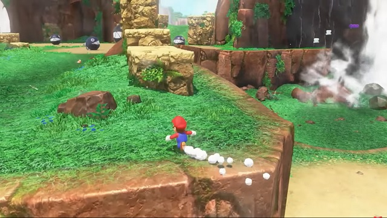&emsp;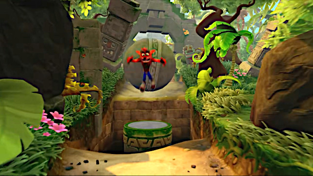 
[左=スーパー マリオ オデッセイ(走る)&emsp;右=クラッシュ バンディクー(ジャンプ)]

## 2. 走る・歩く

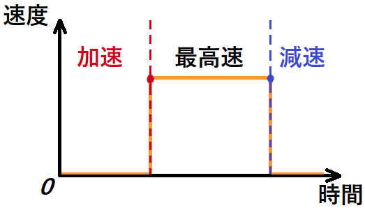&emsp;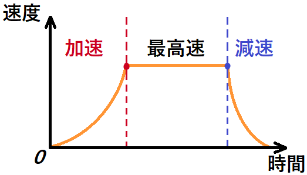 
[デジタルな速度変化/アナログな速度変化]

スティックやキーを入力すると、キャラクターはその方向に移動します。 
みなさんが最初に学んだのは、 **移動と停止** の2つの状態しか持たない、 **デジタル的な移動方法** でしょう。

デジタル的な移動方法の利点は、操作が瞬間的にゲームに反映されることです。 
進みたいと思った瞬間に進める、止まりたいと思ったところで止まれる、という気持ちよさがあります。 
一方で、質量を感じさせないため、ゲーム世界が実在するという感覚は弱くなりがちです。

対して、現代の多くのゲームの移動処理は、 **加速・移動・減速・急ブレーキ・停止** という5つの状態を持ちます。 
この方法では、現実世界と同じように、 **移動速度がアナログ的に変化** します。

アナログ的に変化させる利点は、 **物体の質量を表現できる** ことです。 
ゆっくりと加速してすぐに停止すると重く感じられ、素早く加速してなかなか停止しないと軽く感じられます。 
現実の物体と同じような挙動をさせることで、 実在するキャラクターを操作している感覚が得られます。 
そのかわり、「プレイヤーの意思が即座に反映される」という感覚は弱まります。

このように、「デジタル的な移動」と「アナログ的な移動」には一長一短があります。 
どちらに寄せるべきかはゲーム内容によって異なります。

また、現代のコントローラーの大半はアナログスティックを装備しています。 
そのため、「スティックを倒した角度に応じて速度が変わる」というゲームも多いです。 
プレイヤーが移動速度を制御できると、 **状況に応じて異なる速度を使い分ける遊び** が作れます。 

出発点としては **加速と減速が0.2秒以内に終わるアナログ的な移動** をオススメします。 
わずか「0.2秒」の加減速でも、プレイヤーには物体の質量が伝わります。 
そして、素早い加減速は、デジタルに近い、思い通りに操作できるという感覚を生み出します。

アナログ的な移動は、キャラクターに次のような機能を付け足すことで実現できます。

> 1. 「現在の速度」を表す変数を用意する。
> 2. 毎フレーム、キャラクターに「現在の速度」を加算する。
> 3. キーが入力された方向に応じて「現在の速度」を増やす。
>     * ただし、入力されたキーの向きが移動方向と逆向きの場合、 「現在の速度」を「急ブレーキ」の速度で減らす。
> 4. キーが入力されていなければ「現在の速度」を減らす。
>     * 減らす量が「現在の速度」より大きい場合、「現在の速度」を0にする。

これらを作成した後で、ゲーム内容に合わせて「加速度」と「減速度」を調整していくのがよいでしょう。

移動速度の設定例:

| タイトル                       | 最高速度 | 加速度     | 減速度     | 急ブレーキ |
|:-----------------------------:|---------:|----------:|----------:|----------:|
| スーパーマリオブラザーズ(歩き)   |  8.79m/s | 12.52m/s² | 17.14m/s² | 34.28m/s² |
| スーパーマリオブラザーズ(走り)   | 14.41m/s | 18.79m/s² | 17.14m/s² | 34.28m/s² |
| ソニック・ザ・ヘッジホック(通常) |  9.00m/s |  4.22m/s² |  4.22m/s² | 45.00m/s² |
| ソニック・ザ・ヘッジホック(回転) | 24.00m/s | (角度による) | 2.11m/s² | 11.25m/s² |
| セレステ                       |  8.65m/s | 96.11m/s² | 192.22m/s² | (なし) |

### 移動速度を変化させる

ゲームによっては、特定の操作をすると移動速度が変化します。 
アクションゲームでよく使われるのは **ボタンを押している間だけ最高速度が上がる** ものです。

逆に **攻撃中だけ最高速度が下がる** という機能もありえます。 
これは主に2Dシューティングで使われ、画面を埋め尽くす敵の攻撃をドット単位で避けることを可能にします。

これらの操作を追加することで、「キャラクターを思い通りに操作している」という感覚を高められます。

ただし、 **操作するボタンが増えると操作が難しくなる** ことに注意してください。 
特に初期ステージの設計は、追加の操作に失敗しても問題ないように作るべきでしょう。

また、一般的なノートPC用のキーボードは **同時に認識できるキーの数の制限** があります。 
そのため、選んだキーによっては同時押しが反応せず、意図した操作できない場合があります。

この問題を回避するには、操作を`Shift`キー、`Ctrl`キー、`Alt`キーなどの **特殊キー** に割り当てます。 
特殊キーは他のキーとの同時押しが前提なので「同時に認識できるキーの数」の制限とは別に扱われるからです。

> **【Tips】**
>
> * 移動に「加速」と「減速」を追加すると、物体の重さが感じられて操作に納得感が生まれる。
> * ダッシュなどの操作をキーボードに割り当てるときは「特殊キー」に割り当てるとよい。 
>   「同時に認識できるキーの数」の制限を避けられる。

## 3. ジャンプ

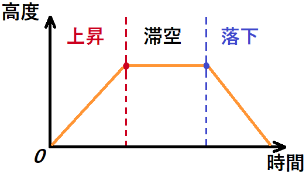&emsp;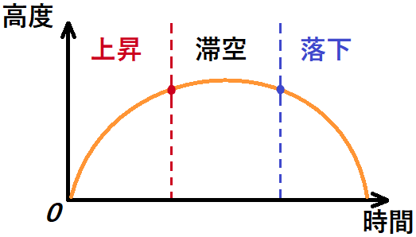 
[デジタルな高度変化/アナログな高度変化]

多くのゲームには「人間基準では大きすぎる障害物や、到底飛び越せないような裂け目」があります。 
そこで、キャラクターには、それらの **障害を乗り越えるための能力** が与えられます。

大抵のアクションゲームでは、その能力は **ジャンプ** です。 
ジャンプは人間にとって自然な動作なので、理解しやすいからです。

ただし、キャラクターのジャンプ力は **大きな障害を乗り越えるのに十分な高さを持つ** ように設定されます。 
普通の人間並のジャンプ力で超えられるような障害ばかりでは、あまり楽しいゲームにはならないからです。

例えば、すべての障害がハードル走のハードルの高さまでしかない場合、「ジャンプで障害物を超えることが楽しい」ゲームにはなりにくいです。

### 重力の設定

地球と同じ重力で高いジャンプをさせると、ボールのようにふわりとした挙動になって現実感がなくなります。 
そこで、多くのゲームでは **重力を強く** したり、重力の代わりに **数式によってジャンプを制御** します。

例えば、初代スーパーマリオブラザーズのジャンプは、

&emsp;**ボタンを押しているときより、ボタンを離したあとのほうが重力が強くなる**

ようになっています。 
ボタンを早く離せばすぐに重力が強くなり、低いジャンプになります。逆に、遅く離せば高いジャンプになります。

初代ロックマンにも似た仕組みがあります。 
上昇速度が6.61m/sより大きいときにジャンプボタンを離すと、即座に上昇速度が3.3m/sに設定されます。

また、格闘ゲームでは **キャラクターごとにジャンプ力と重力を変えて個性を演出** しています。 
身軽なキャラクターのジャンプは高くて速く、鈍重なキャラクターのジャンプは遅くて低く、 
特殊な力を持つキャラクターのジャンプは紙風船のようにゆるやか、という具合です。

これらのジャンプ挙動は現実世界ではありえませんが、ゲーム世界では **面白ければなんでもあり** です。

ジャンプ速度の設定例:

| タイトル                     | 初速     | 通常重力   | 落下時重力  | 最大落下速度 |
|:----------------------------|---------:|----------:|-----------:|------------:|
| スーパーマリオブラザーズ(通常) | 22.50m/s | 42.19m/s² | 147.66m/s² | (無制限) |
| スーパーマリオブラザーズ(走り) | 28.12m/s | 52.73m/s² | 189.84m/s² | (無制限) |
| ロックマン1, 2               | 16.07m/s | 49.50m/s² |  49.50m/s² | 39.6m/s |
| セレステ                     | 20.00m/s | 67.00m/s² |  67.00m/s² | 15.38m/s 23.07m/s |

補足: マリオは速度によってジャンプ挙動が変化。セレステは下入力で最大落下速度が増加。

### ジャンプ中にできること

ジャンプに関しては、 **空中にいるときに可能な移動操作** についても考える必要があります。 
例えば、次のような操作が考えられます。

> * 向いている方向を変えられる
> * 水平方向の移動速度を変えられる

**ジャンプ中に向いている方向を変える** 操作には「背後の敵を攻撃できる」という利点があります。 
射撃要素を含むゲームでは検討する価値があるでしょう。

**移動速度を変えられる** 操作には「着地点を制御できる」という利点があります。 
例えば、スーパーマリオの主要な攻撃手段は「踏みつけ」なので、空中で位置を微調整できると便利です。

また、 **制御できる程度** もゲーム内容に影響します。 
例えば、ロックマンには踏みつけがなく、「敵の攻撃を素早くかわして進む」ことが求められます。 
そのため、空中も地上並の速度で移動できることが役立ちます。

> **【Tips】**
>
> * ジャンプを楽しいものにするには、ジャンプ力と速度をゲームに合わせて調整する。
> * ジャンプ中に向きや位置を変えられるかどうかは、作りたいゲームによって異なる。

### 寛容なジャンプ

崖のぎりぎりでジャンプボタンを押したつもりが落ちてしまった、なんてことはありがちです。 
一部のゲームでは **崖から落ちた直後ならジャンプできる** ようにして、このような悲劇を回避しています。

また、ソニック・ザ・ヘッジホッグでは、 **地形に対する判定を、それ以外の衝突判定よりわずかに大きく設定**  
しています。敵には当たりにくくしながらも、地形の崖のぎりぎりに立つことを可能にしています。

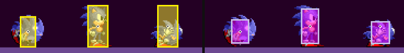 
[左=地形に対する判定の大きさ&emsp;右=敵などに対する判定の大きさ]

他にも、着地してすぐジャンプボタンを押したつもりが、まだ着地前だった、ということもありがちです。 
これも **着地直前にジャンプボタンが押されたら、着地後に即座にジャンプする** という仕組みで回避できます。

ゲームを気持ちよく遊んでもらうためには、このような小さな工夫が重要です。

## 4. 特殊な移動方法/攻撃方法(ダッシュや壁登りなど)

大抵のアクションゲームには、ゲームを特徴づける **特殊な操作** があります。 
種類が多すぎるためすべてを網羅することはできませんが、いくつか挙げてみましょう。

> * 空中でもう一度ジャンプ(二段ジャンプ)
> * 高速ダッシュ
> * 壁を蹴ってジャンプ
> * 壁に張り付いて移動
> * 滑空
> * スライディング
> * 前転、横転、バク転
> * ロープで振り子のように移動
> * 武器の反動で後ろ向きに移動

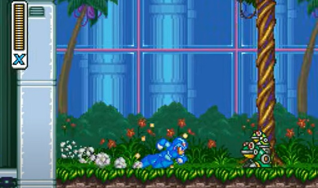&emsp;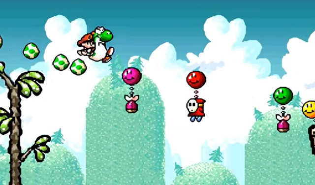 
[左=ロックマンXのダッシュ&emsp;右=ヨッシーアイラインドの踏ん張りジャンプ(滑空)]

これらは「走り」「ジャンプ」に次ぐ **第三の移動手段** となります。 
うまく設計できれば、技術力のアピール材料としても役立つでしょう。

これらの特殊操作においても、 **操作して気持ちの良いものになるまで、パラメータを調整する** ことが重要です。 
例えば、ジャンプと同様に「加速」「減速」があると操作感が良くなります。

また、 **エフェクトや効果音を追加** して、「特殊操作が可能」とか「特殊操作を実行中」という状態が、 
プレイヤーに伝わるようにすることも大切です。

攻撃要素が強いアクションゲームの場合、移動だけでなく **攻撃に関する特殊操作** があるとよいでしょう。

> * ダッシュ攻撃
> * 連続攻撃
> * 必殺技
> * キー入力方向よって攻撃の種類が変わる

シューティング要素があるゲームでは、攻撃は特に重要な要素です。以下のような特殊操作が考えられます。

> * 溜め攻撃
> * 回数制限のある強力な攻撃
> * 攻撃方向の変更
> * 複数の武器の切り替え

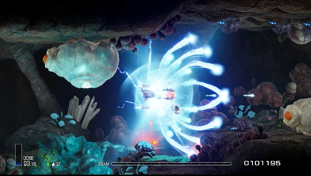&emsp;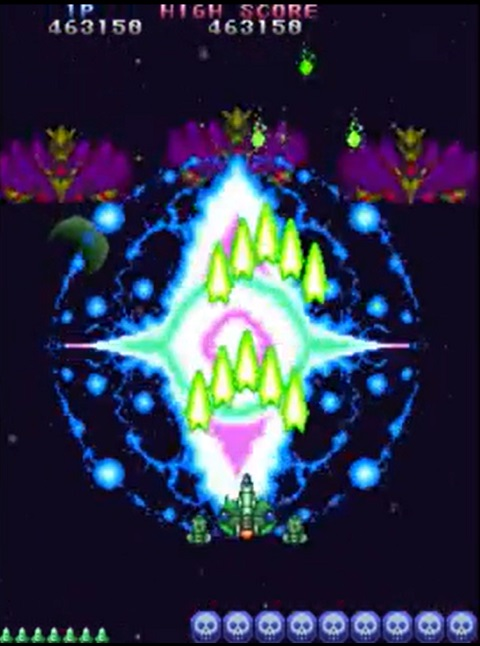 
[左=R-TYPEの溜め攻撃&emsp;右=TATSUJINのボム攻撃]

> **【Tips】**
>
> * ゲームを特徴づける「特殊な操作(機能)」があると、ゲームの遊び方が広がる。 
>   技術力のアピール材料になる。
> * ゲームのジャンル次第だが、「移動」だけでなく「攻撃」や「防御」の特殊操作の追加も考慮する。
> * エフェクトや効果音によって、「プレイヤーが可能な操作」や「操作の結果」をプレイヤーに伝える。

<pre class="tnmai_assignment">
<strong>【課題】</strong>
プランナー:
2Dジャンプアクションゲームを想定し、以下の要素を含む移動とジャンプの仕様書を作成しなさい。
UnityやUEでカプセルを動かす仕組みを作ってみるとイメージしやすいでしょう。
可能であれば「特殊な操作」の仕様も追加すること。

ゲーム仕様:
  - 重視する操作性: 精密な操作(狭い足場がある), スピード感(狭い足場はない)
  - 主体となる操作: ジャンプ, 近接攻撃, 射撃
  - カメラとキャラクターの距離: 近い(キャラを大きく見せる、ステージの狭い範囲を表示)
    　　　　　　　　　　  遠い(キャラを小さく見せる、ステージを広く表示)
  - 時間の単位: 秒, 1/60フレーム
  - 距離の単位: メートル, ドット

移動の仕様:
  - 最高速度
  - 加速度
  - 減速度
  - 急ブレーキ

ジャンプの仕様:
  - 初速
  - 重力
  - 入力によって速度や重力が変化する場合、その仕組みを書く

プログラマ:
これまでに作成した、または作成中のゲームのキャラクターに、以下の機能を実装しなさい。
  - アナログ的な移動
  - 移動やジャンプにエフェクトと効果音を追加しなさい。
</pre>

>**【参考動画】** 
>Celesteの操作が心地よい理由 - Game Maker's Toolkit 
><https://www.youtube.com/watch?v=yorTG9at90g>
>
>プラットフォーマー・ツールキット - Game Maker's Toolkit 
><https://www.youtube.com/watch?v=zWi0jgghGcI>
>
>速度の単位 - 桜井政博のゲームを作るには 
><https://www.youtube.com/watch?v=DDcEGLyaVMU>
>
>ジャンプの仕組み - 桜井政博のゲームを作るには 
><https://www.youtube.com/watch?v=zxOBCjqP8-Y>
>
>ガケぎわのふるまい - 桜井政博のゲームを作るには 
><https://www.youtube.com/watch?v=R80GEUbK2Fo>
